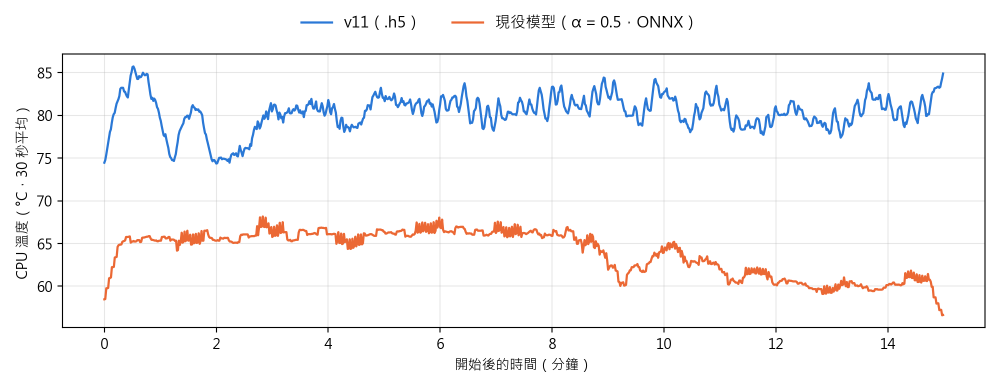
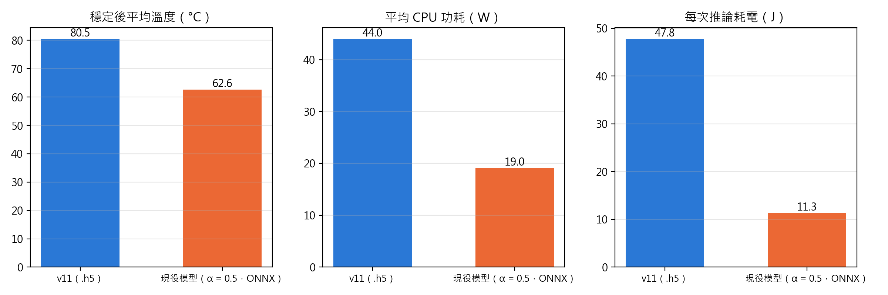
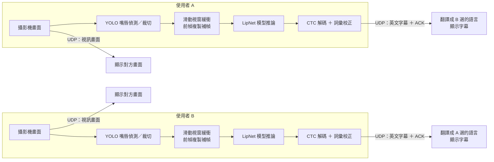

# LipNet 唇語辨識模型輕量化研究

以 [LipNet](https://arxiv.org/abs/1611.01599) 架構為基礎，目標是在**不犧牲準確率的前提下**，讓唇語辨識模型能在沒有獨立顯示卡的普通筆電上即時運作，服務聽障人士在吵雜或聽不清楚聲音的環境下溝通。

## 重點成果

在同一批模型、同一次量測下，**CPU 推論快 5.6 倍、檔案縮小到 1/6，錯誤率沒有顯著變化**。

| 模型 | 檔案大小 | CPU 延遲 | 相對 v11 | WER（錯誤率） |
|---|---|---|---|---|
| v11（基準，.h5） | 101.8 MB | 1543.7 ms | 1.0× | 17.1% |
| ＋架構輕量化（α = 0.5，.h5） | 49.4 MB | 605.5 ms | 2.5× | 17.8% |
| **＋格式轉換（α = 0.5，ONNX）** | **16.5 MB** | **274.7 ms** | **5.6×** | **17.8%** |

- 兩段優化效果可以相乘：架構輕量化快 2.5 倍，格式轉換再快 2.2 倍
- 只做格式轉換、不做輕量化時，v11 只快 1.7 倍，兩段缺一不可
- 限制 CPU 只用 1 條執行緒模擬低階電腦時，v11 辨識一次要 4.1 秒，最終模型只要 0.72 秒
- 以即時通話節奏持續運作時，CPU 溫度低約 18°C，每次推論耗電約為原本的 1/4

## 研究方法

**基準模型 v11**：沿用既有的 LipNet 實作（Conv3D 128／256／75 ＋ 2 層 BiLSTM 128），每層 Conv3D 後加入 BatchNorm 重新訓練，共 8,473,760 個參數。

依序進行三項實驗，每項只改變一個變因：

1. **嘴唇偵測器選型**：v11 分別搭配 YOLOv5／v8／v10
2. **架構輕量化**：Conv3D 通道數乘以寬度係數 α（1.0／0.75／0.5／0.25），從頭訓練
3. **部署格式轉換**：.h5 → ONNX（另比較 TFLite 與 INT8 量化），權重不變、不重新訓練

最後再以溫度與功耗實驗，比較輕量化前後模型長時間運作時對硬體的負擔。

主實驗使用 GRID 說話者 s1：以固定隨機種子切分訓練 800 支、評估 200 支（訓練時沒看過的影片），每項設定以 5 個隨機種子各訓練一次。WER 為單字錯誤率（套用詞彙校正後），越低越好。CPU 延遲為純 CPU（Intel i7-11800H）量測。

## 實驗結果

### 1. 偵測器：選 YOLOv8

| 偵測器 | 偵測器 CPU 耗時 | WER（v11，五輪平均） |
|---|---|---|
| YOLOv5 | 59.2 ms | 五次訓練皆未收斂 |
| **YOLOv8** | **36.9 ms** | **17.1%** |
| YOLOv10 | 41.3 ms | 18.6% |

YOLOv8 與 YOLOv10 準確度相當（差距小於隨機波動），YOLOv8 偵測最快。YOLOv5 有 6.4% 影片偵測不到嘴唇，五次訓練全部失敗。

### 2. 寬度：選 α = 0.5

| α | 參數量 | CPU 延遲 | 相對 v11 | WER（五輪平均） |
|---|---|---|---|---|
| 1.0（v11） | 8,473,760 | 749.5 ms | 1.0× | 17.1% ±2.7 |
| 0.75 | 6,203,393 | 532.3 ms | 1.4× | 19.3% ±1.8 |
| **0.5** | **4,109,282** | **322.6 ms** | **2.3×** | **17.8% ±1.7** |
| 0.25 | 2,191,427 | 157.2 ms | 4.8× | 18.8% ±2.5 |

各 α 與 v11 的差距皆不顯著（配對 t 檢定 p > 0.05）。α = 0.5 與 v11 差距最小、波動最小，參數減少 51.5%。

### 3. 部署格式：選 ONNX

| 格式 | 相對 .h5 速度 | 說明 |
|---|---|---|
| **ONNX float32** | **快 1.9 倍** | 全部運算子原生支援 |
| ONNX INT8 | 快 1.9 倍 | 只量化 BiLSTM／Dense，佔 99% 運算量的 Conv3D 未量化，幾乎沒有額外加速 |
| TFLite float32 | 慢 7.8 倍 | MaxPool3D 不支援，需退回 TensorFlow 執行 |
| TFLite INT8 | 慢 7.8 倍 | 同上 |

格式轉換與量化皆不影響辨識準確率。（此表為現役模型的獨立量測，速度倍數不與上方表格混用。）

### 4. 溫度與功耗：輕量化後 CPU 更涼、更省電

比較全部資料訓練的 v11 與現役模型（α = 0.5，ONNX）。模擬即時通話節奏，兩個模型都以純 CPU 每 0.6 秒推論一次，各執行 15 分鐘、重複 2 輪（每輪前冷卻至起始溫度）。CPU 溫度與功耗以 LibreHardwareMonitor 讀取處理器內建感測器（CPU Package），每秒取樣一次。

| 模型 | 穩定後溫度 | 平均 CPU 功耗 | 每次推論耗電 | 平均延遲 |
|---|---|---|---|---|
| v11（.h5） | 80.5°C | 44.0 W | 47.8 J | 1095 ms（跟不上 0.6 秒間隔） |
| **α = 0.5（ONNX）** | **62.6°C** | **19.0 W** | **11.3 J** | **161 ms** |

輕量化後 CPU 溫度低約 18°C，每次推論耗電約為原本的 1/4。起始待機溫度 47.3°C；單一筆電、平衡電源模式下量測，功耗只計 CPU。（延遲為本實驗另一次量測，與上方表格不同場次，只在本表內比較。）

### 5. 其他結論

- **Transformer 取代 BiLSTM**：參數量相同下錯誤率打平，維持 BiLSTM
- **封包遺失補救**：丟失 10% 畫面時，複製前一幀的正確率為 53～74%，補黑畫面只有 0～4%

## 系統

雙向即時通話系統，攝影機畫面經 YOLOv8 嘴唇偵測、裁切後送入 LipNet 推論，經 CTC 解碼與詞彙校正產生字幕，並支援多語言翻譯。可直接以 Python 執行（附批次檔一鍵啟動），兩台電腦即可進行雙向通話示範。

雙方各自在本機完成「偵測→辨識→解碼」，只透過 UDP 傳送視訊畫面與英文字幕；翻譯由接收方依自己選的語言進行。

## 限制

- 主實驗只使用 1 位說話者（GRID s1）、800 支訓練影片，錯誤率只用於比較設定之間的相對差異，不代表系統實際表現
- 對訓練時沒看過的新說話者，辨識能力仍不足
- 低算力測試是在同一顆 CPU 上限制執行緒的模擬，未在其他硬體上實測

## 參考文獻

- Assael, Y. M., Shillingford, B., Whiteson, S., & de Freitas, N. *LipNet: End-to-End Sentence-level Lipreading.* arXiv:1611.01599.
- Ma, P., Martinez, B., Petridis, S., & Pantic, M. *Towards Practical Lipreading with Distilled and Efficient Models.* **ICASSP 2021.** arXiv:2007.06504.
- *LiteVSR: Efficient Visual Speech Recognition by Learning from Speech Representations of Unlabeled Data.* **ICASSP 2024.** arXiv:2312.09727.
- *A Lightweight Lip-Reading Model with Image Difference Fusion.* **WCI3DT 2024.**
