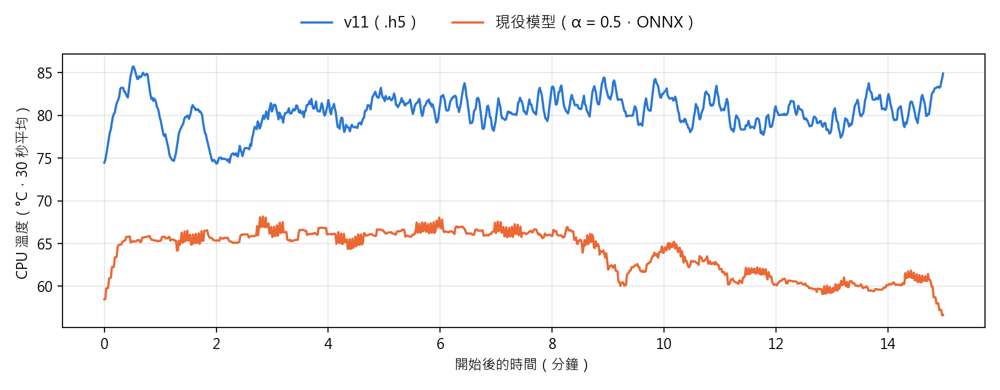
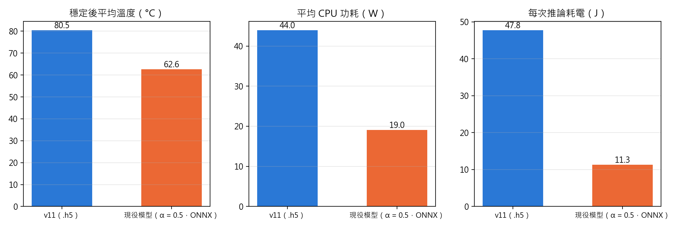
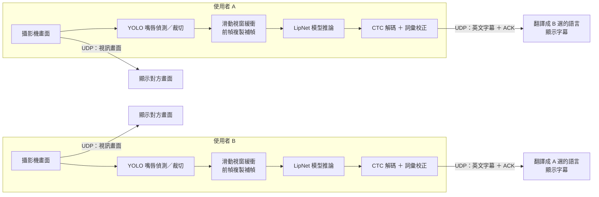

# LipNet 唇語辨識模型輕量化研究

以 [LipNet](https://arxiv.org/abs/1611.01599) 架構為基礎，目標是在**不犧牲準確率的前提下**，讓唇語辨識模型能在沒有獨立顯示卡的普通筆電上即時運作，服務聽障人士在吵雜或聽不清楚聲音的環境下溝通。

## 重點成果

在同一次量測下，**α = 0.25 ONNX INT8 的 CPU 推論比 v11 快 19.3 倍、檔案縮小到約 1/40，表中錯誤率沒有變差**。

| 模型 | 檔案大小 | CPU 延遲 | 相對 v11 | WER（錯誤率） |
|---|---|---|---|---|
| v11（基準，.h5） | 97.1 MB | 747.7 ms | 1.0× | 14.56% |
| ＋架構輕量化（α = 0.25，.h5） | 25.2 MB | 155.5 ms | 4.8× | 12.80% |
| ＋格式轉換（α = 0.25，ONNX float32） | 8.4 MB | 38.7 ms | 19.3× | 12.80% |
| **＋量化（α = 0.25，ONNX INT8）** | **2.4 MB** | **38.8 ms** | **19.3×** | **12.81%** |

WER 為 s3、s4、s5、s6、s7、s13 共 5,929 支影片的加權結果，影片皆已參與訓練，只反映對訓練資料的擬合程度。模型由 9 位說話者訓練，完整結果見「多說話者驗證」。CPU 延遲為中位數，只計模型推論，不含 CTC 解碼（純 CPU、高效能模式，5 輪、每輪 20 次）。

- 兩段優化效果可以相乘：架構輕量化快 4.8 倍，格式轉換再快 4.0 倍
- 先前 α = 0.5 模型的實測：限制 CPU 只用 1 條執行緒模擬低階電腦時，v11 辨識一次要 4.1 秒，α = 0.5 ONNX 只要 0.72 秒
- 先前 α = 0.5 模型的實測：以即時通話節奏持續運作時，CPU 溫度低約 18°C，每次推論耗電約為原本的 1/4

## 研究方法

**基準模型 v11**：沿用既有的 LipNet 實作（Conv3D 128／256／75 ＋ 2 層 BiLSTM 128），每層 Conv3D 後加入 BatchNorm 重新訓練，共 8,473,760 個參數。

依序進行三項實驗，每項只改變一個變因：

1. **嘴唇偵測器選型**：比較 YOLOv5／v8／v10 的 CPU 耗時
2. **架構輕量化**：Conv3D 通道數乘以寬度係數 α（1.0／0.75／0.5／0.25），從頭訓練，結果見「多說話者驗證」
3. **部署格式轉換**：.h5 → ONNX（另比較 TFLite 與 INT8 量化），權重不變、不重新訓練

最後再以溫度與功耗實驗，比較輕量化前後模型長時間運作時對硬體的負擔。

模型使用 GRID 9 位說話者（s1～s8、s13）訓練，切分與測試方式見「多說話者驗證」。WER 為單字錯誤率（未套用詞彙校正），只計長度大於 1 的單字（每句 5 個單字，字母位不計），越低越好。CPU 延遲為純 CPU（Intel i7-11800H）量測。

## 實驗結果

### 1. 偵測器：選 YOLOv8

| 偵測器 | 偵測器 CPU 耗時 |
|---|---|
| YOLOv5 | 59.2 ms |
| **YOLOv8** | **36.9 ms** |
| YOLOv10 | 41.3 ms |

YOLOv8 的 CPU 耗時最低。

### 2. 部署格式：選 ONNX

| 格式 | 檔案大小 | CPU 延遲 | 相對 .h5 速度 | WER（9 人） | 說明 |
|---|---|---|---|---|---|
| .h5 | 25.2 MB | 155.5 ms | 1.0× | 13.69% | 原始模型 |
| ONNX float32 | 8.4 MB | 38.7 ms | 快 4.0 倍 | 13.69% | 全部運算子原生支援 |
| **ONNX INT8** | **2.4 MB** | **38.8 ms** | **快 4.0 倍** | **13.70%** | 只量化 BiLSTM／Dense，Conv3D 未量化，幾乎沒有額外加速，但檔案最小 |
| TFLite float32 | 8.4 MB | 802.6 ms | 慢 5.2 倍 | 13.80% | MaxPool3D 不支援，需退回 TensorFlow 執行 |
| TFLite INT8 | 2.4 MB | 805.2 ms | 慢 5.2 倍 | 13.80% | 同上 |

此表為 α = 0.25（全資料版）的同場次量測。WER 使用 9 位說話者共 8,790 支已參與訓練的影片，只用來比較格式轉換前後是否改變。

### 3. 溫度與功耗：輕量化後 CPU 更涼、更省電

此節為先前 α = 0.5 模型的實測，α = 0.25 尚未進行溫度實驗。比較全部資料訓練的 v11 與現役模型（α = 0.5，ONNX）。模擬即時通話節奏，兩個模型都以純 CPU 每 0.6 秒推論一次，各執行 15 分鐘、重複 2 輪（每輪前冷卻至起始溫度 +2°C 以內）。CPU 溫度與功耗以 LibreHardwareMonitor 讀取處理器內建感測器（CPU Package），每秒取樣一次。

| 模型 | 穩定後溫度 | 平均 CPU 功耗 | 每次推論耗電 | 平均延遲 |
|---|---|---|---|---|
| v11（.h5） | 80.5°C | 44.0 W | 47.8 J | 1095 ms（跟不上 0.6 秒間隔） |
| **α = 0.5（ONNX）** | **62.6°C** | **19.0 W** | **11.3 J** | **161 ms** |

輕量化後 CPU 溫度低約 18°C，每次推論耗電約為原本的 1/4。起始待機溫度 47.3°C；單一筆電、平衡電源模式下量測，功耗只計 CPU。（延遲為本實驗另一次量測，與上方表格不同場次，只在本表內比較。）

### 4. 多說話者驗證：9 位說話者 × 4 種 α

為比較不同寬度係數在多位說話者上的表現，使用 GRID 9 位說話者（s1～s8、s13）進行 α 實驗。每人以固定隨機種子切分 80% 訓練、20% 驗證（共訓練 7,024 支、驗證 1,766 支；訓練前即依「嘴唇偵測率低於 50%」排除 162 支影片），另以**完全沒參與訓練**的說話者 s9（1,000 支）測試對新說話者的辨識能力。各 α 從頭訓練後再以低學習率微調，下表為微調後結果。

| α | 參數量 | 驗證集 WER | s9 WER（新說話者） |
|---|---|---|---|
| 0.25 | 2,191,427 | 20.9% | 65.7% |
| 0.5 | 4,109,282 | 20.1% | 71.9% |
| 0.75 | 6,203,393 | 20.1% | 65.8% |
| 1.0 | 8,473,760 | 22.2% | 77.7% |

WER 為未套用詞彙校正的原始輸出。驗證集同時用於決定停止訓練的輪數，數字略為樂觀。

- 驗證集上 α = 0.5 與 0.75 並列最低，最大的 α = 1.0 反而最高；4 個點以二次曲線擬合呈 U 形，最低點約在 α ≈ 0.56（R² = 0.97）
- 9 位說話者中 s8 在所有模型都最難辨識（約高出其他人 5 個百分點），但其偵測率 95.0%，無資料品質上的排除理由，因此保留
- 對新說話者 s9，所有 α 的錯誤率都升到 66～78%，α = 0.5 在 s9 上並非最佳；跨說話者的泛化是所有寬度共同的限制。s9 有鬍鬚，嘴唇偵測率僅 41.8%，錯誤率可能因外觀差異與偵測失敗而被放大

#### 完整 WER

除上表外，另以「訓練＋驗證」共 8,790 支影片從頭訓練固定 32 輪（全資料版）。全資料版的測試影片模型都看過，只反映對訓練資料的擬合程度；未參與訓練的欄位與 s9 使用上表的微調版。競賽報告僅列其中 6 位（s3、s4、s5、s6、s7、s13），未包含 s1、s2、s8；各模型都是由 9 位說話者訓練。

| α | 已參與訓練：6 人（5,929 支） | 已參與訓練：9 人（8,790 支） | 未參與訓練：6 人（1,188 支） | 未參與訓練：9 人（1,766 支） | s9（1,000 支） |
|---|---|---|---|---|---|
| 1.0 | 14.56% | 15.44% | 21.38% | 22.19% | 77.70% |
| 0.75 | 13.16% | 14.02% | 19.34% | 20.08% | 65.84% |
| 0.5 | 13.52% | 14.43% | 19.49% | 20.07% | 71.86% |
| 0.25 | 12.80% | 13.69% | 20.07% | 20.87% | 65.68% |

「未參與訓練」的影片曾用於決定停止訓練的輪數，數字略為樂觀。全資料版的影片訓練時都看過，不代表模型面對新影片的表現。

#### α = 0.25（全資料版）各說話者的格式轉換結果（WER）

| 說話者 | 影片數 | .h5 | ONNX float32 | ONNX INT8 | TFLite float32 | TFLite INT8 |
|---|---|---|---|---|---|---|
| s1 | 866 | 13.12% | 13.12% | 13.14% | 13.16% | 13.16% |
| s2 | 1,000 | 12.46% | 12.46% | 12.50% | 12.60% | 12.58% |
| s3 | 998 | 12.97% | 12.97% | 12.95% | 13.27% | 13.23% |
| s4 | 960 | 12.71% | 12.71% | 12.69% | 12.79% | 12.83% |
| s5 | 1,000 | 12.70% | 12.70% | 12.70% | 12.78% | 12.80% |
| s6 | 986 | 12.54% | 12.54% | 12.52% | 12.52% | 12.52% |
| s7 | 999 | 12.77% | 12.77% | 12.79% | 12.91% | 12.91% |
| s8 | 995 | 20.68% | 20.68% | 20.72% | 20.68% | 20.76% |
| s13 | 986 | 13.14% | 13.14% | 13.23% | 13.39% | 13.31% |
| **6 人加權平均**（s3～s7、s13） | **5,929** | **12.80%** | **12.80%** | **12.81%** | **12.94%** | **12.93%** |
| **9 人加權平均** | **8,790** | **13.69%** | **13.69%** | **13.70%** | **13.80%** | **13.80%** |

這些影片模型都看過，本表只用來比較格式轉換前後的 WER 是否改變。

**為什麼沒有再增加說話者**：提升對新說話者的泛化能力，最直接的方法是加入更多不同的說話者（GRID 共 34 位、約 3.4 萬支影片）。但每位說話者裁切後的訓練資料約佔 1.9 GB，目前電腦硬碟只剩約 22 GB，無法再載入上萬支影片進行訓練，因此本研究以 9 位說話者為上限，跨說話者泛化列為未來工作。

### 5. 其他結論

- **Transformer 取代 BiLSTM**：參數量相同下錯誤率打平（WER 數據待補），維持 BiLSTM
- **封包遺失補救**：丟失 10% 畫面時，11 位說話者中複製前一幀的正確率為 0～74%（其中 s5、s6、s7、s34_3 為 53～74%），補黑畫面為 0～4%

## 系統

雙向即時通話系統，攝影機畫面經 YOLOv8 嘴唇偵測、裁切後送入 LipNet 推論，經 CTC 解碼與詞彙校正產生字幕，並支援多語言翻譯。可直接以 Python 執行（附批次檔一鍵啟動），兩台電腦即可進行雙向通話示範。

雙方各自在本機完成「偵測→辨識→解碼」，只透過 UDP 傳送視訊畫面與英文字幕；翻譯由接收方依自己選的語言進行。

## 限制

- 多說話者驗證只使用 9 位說話者，錯誤率只用於比較設定之間的相對差異，不代表系統實際表現
- 對訓練時沒看過的新說話者，辨識能力仍不足（s9 錯誤率 66～78%）；受限於電腦硬碟空間，無法再載入上萬支影片加入更多說話者訓練來提升泛化性
- 低算力測試是在同一顆 CPU 上限制執行緒的模擬，未在其他硬體上實測

## 參考文獻

- Assael, Y. M., Shillingford, B., Whiteson, S., & de Freitas, N. *LipNet: End-to-End Sentence-level Lipreading.* arXiv:1611.01599.
- Ma, P., Martinez, B., Petridis, S., & Pantic, M. *Towards Practical Lipreading with Distilled and Efficient Models.* **ICASSP 2021.** arXiv:2007.06504.
- *LiteVSR: Efficient Visual Speech Recognition by Learning from Speech Representations of Unlabeled Data.* **ICASSP 2024.** arXiv:2312.09727.
- *A Lightweight Lip-Reading Model with Image Difference Fusion.* **WCI3DT 2024.**
